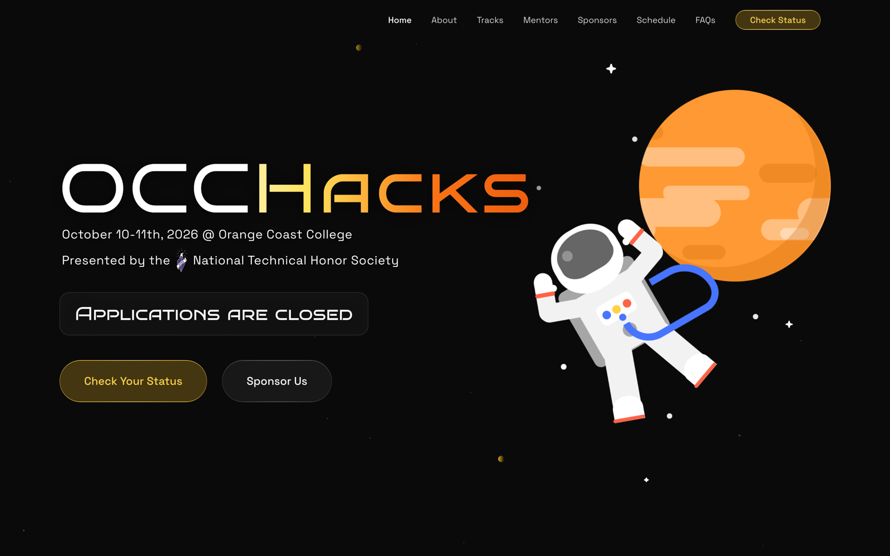
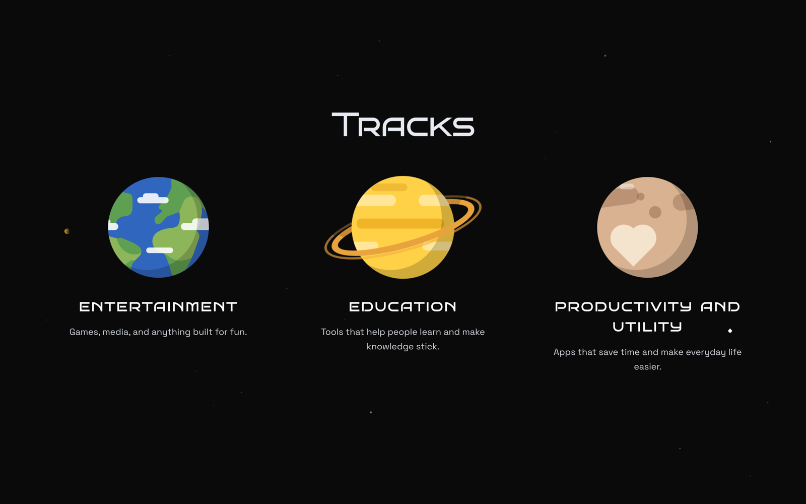
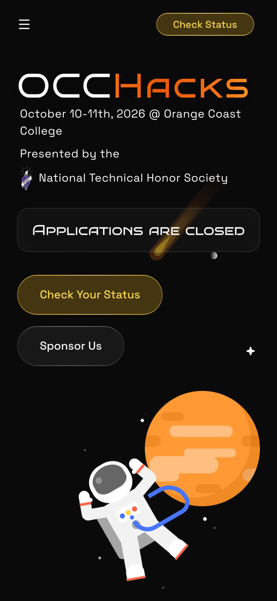
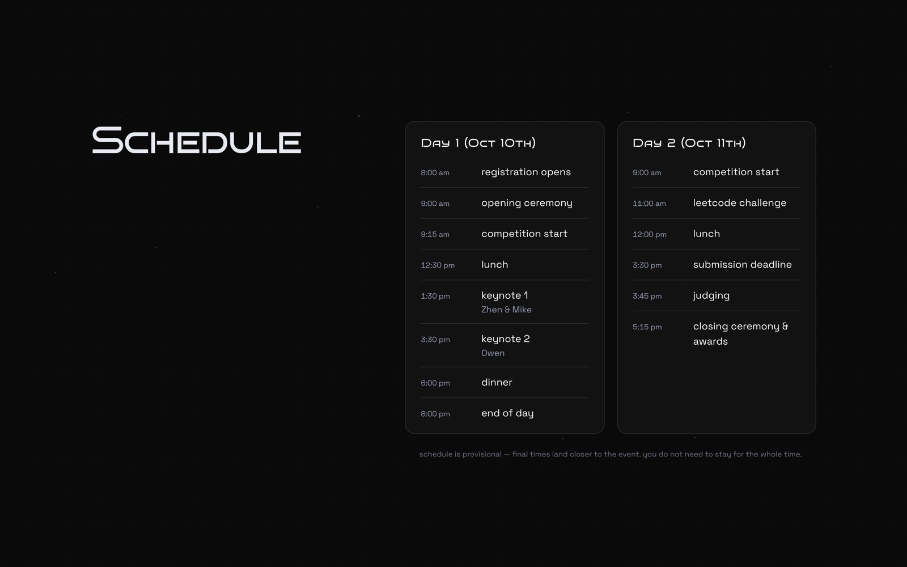
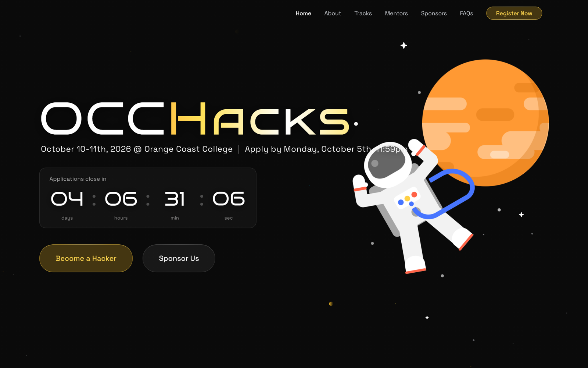
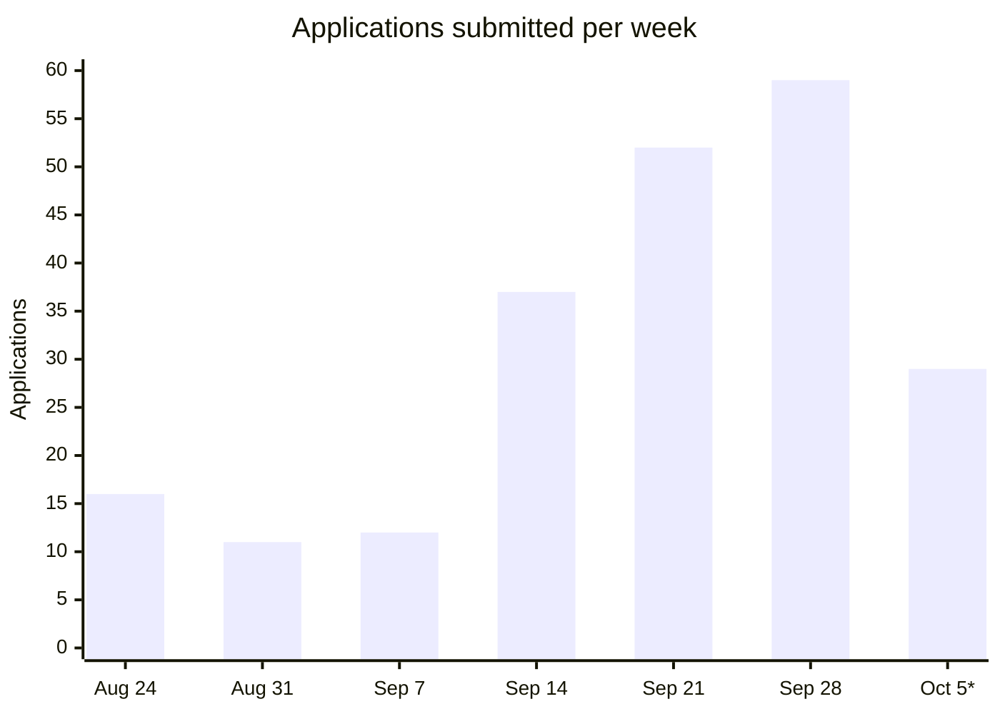

<div align="center">

# OCC Hacks 2026

A free two-day hackathon at Orange Coast College, October 10–11, 2026,
run by the Iota Xi (ΙΞ) Society.

[occhacks.com](https://occhacks.com) ·
[Admin dashboard docs](docs/admin-dashboard.md) ·
[Design system](docs/design-system.md)




</div>

## What's in here

One Next.js app holds the whole event:

- **The landing page** — hero, about, tracks, mentors, sponsors, schedule and FAQ
- **Three sign-up forms** — hackers at `/register`, plus `/volunteer` and `/mentor`
- **An organizer dashboard** at `/admin` — applicants, check-in, volunteers and mentors, email campaigns, CSV export

<table>
  <tr>
    <td width="68%"></td>
    <td rowspan="2"></td>
  </tr>
  <tr>
    <td></td>
  </tr>
</table>

## How it went

OCC Hacks 2026 ran October 10–11 in the OCC Ballroom: two days, three tracks
(Entertainment, Education, and Productivity and Utility), free for any college
student 18 or older. Applications opened in late August and closed Monday,
October 5 at 11:59 PM PT, with no walk-ins.



<sub>The homepage while applications were open. After the deadline the
countdown became an "Applications are closed" notice and every apply button
became a status check.</sub>

### Applications

| Stage | Count |
| --- | --- |
| Submitted applications | 216 |
| Started but never submitted | 27 |
| Accepted | 211 |
| Confirmed they were coming | 141 |
| Application window | Aug 24 – Oct 5, about six weeks |

- The deadline drove the rush. 81 applications, 38% of the total, came in
  during the final week, and deadline day itself was the busiest of the cycle
  with 29. The last one landed at 11:57 PM, two minutes before the form closed.
- First-choice track: Entertainment 86, Productivity and Utility 69,
  Education 61.



<sub>\*Oct 5 is deadline day only. Aug 24 includes one early test submission.</sub>

### Site traffic

From PostHog, Aug 24 – Oct 16. Visitors with ad blockers aren't counted, so
these are floors.

| Metric | Value |
| --- | --- |
| Page views | 12,267 |
| Unique visitors | about 1,500 |
| Sessions | 3,496 |
| Desktop / mobile | 57% / 43% |
| Busiest week | Oct 5, with 604 visitors |

Most people typed the address or followed a shared link (about 1,250
visitors), then Google search (about 380), then Instagram and the Devpost
listing (about 30 each).

## Contents

- [How it went](#how-it-went)
- [Quick start](#quick-start)
- [Stack](#stack)
- [Routes](#routes)
- [Project layout](#project-layout)
- [Scripts](#scripts)
- [Working in this repo](#working-in-this-repo)

## Quick start

```bash
npm install
cp .env.example .env.local   # then fill it in
npm run dev
```

The site comes up on <http://localhost:3000>.

> [!NOTE]
> Without Supabase credentials the app boots but nothing that touches the
> database works. In development the proxy lets you open the sign-up forms
> signed out so you can look at them; saving still requires a session.

<details>
<summary><strong>Environment variables</strong></summary>

| Variable | What it does |
| --- | --- |
| `NEXT_PUBLIC_SUPABASE_URL` | Supabase project URL (Project Settings → API) |
| `NEXT_PUBLIC_SUPABASE_ANON_KEY` | Supabase anon key |
| `RESEND_API_KEY` | Email sending. Omit it and every send is skipped with a warning — the rest of the app is unaffected. |
| `RESEND_FROM` | Sender address, on a domain verified at resend.com/domains |
| `RESEND_REPLY_TO` | Optional reply-to |
| `NEXT_PUBLIC_POSTHOG_KEY` | PostHog project token. Missing in development, this throws on purpose, so events are never silently dropped. |
| `NEXT_PUBLIC_POSTHOG_HOST` | PostHog host |

</details>

## Stack

| Layer | Choice |
| --- | --- |
| Framework | Next.js 16 (App Router), React 19, TypeScript |
| Styling | Tailwind CSS v4, shadcn/ui over Base UI and Radix |
| Data and auth | Supabase — OAuth sign-in, Postgres, and the row-level security policies the dashboard reads through |
| Email | Resend, for transactional and campaign mail |
| Analytics | PostHog, including production error tracking |
| Motion | `motion` for animation, `ogl` for the space backdrop |

There is no service-role key in this project; every query runs as the
signed-in user.

## Routes

| Route | Who it's for | Notes |
| --- | --- | --- |
| `/` | Everyone | Landing page, with JSON-LD for the event and the FAQ |
| `/register` | Hackers | Multi-step application |
| `/volunteer`, `/mentor` | People helping run the weekend | Same multi-step form, different questions |
| `/status` | Hackers | Application status, plus the check-in QR code once accepted |
| `/handbook` | Confirmed hackers | Everything needed for the weekend |
| `/signin`, `/auth/callback` | Everyone | OAuth sign-in; the callback handles both the PKCE `?code=` flow and the `?token_hash=` template flow |
| `/admin` | Organizers | Dashboard, Applicants, Volunteers & mentors, Check-in, Emails, Hacker handbook, Settings |
| `/admin/export` | Organizers | Streams the roster as CSV |

A few things worth knowing:

- **Sign-up forms autosave** a draft as you go — partial rows in Postgres,
  plus a local copy per role. A finished sign-up sends one welcome email to
  the address the account signed in with.
- **Everyone has to be 18 by day one.** The rule lives once, in
  `lib/eligibility.ts`, and both the form and the server action read it from
  there.
- **CSV export reuses the applicant list's query string**, so "export what
  I'm looking at" needs no second filter implementation.
- **Admin access is one list** in `lib/admin/access.ts`, checked in three
  places — the proxy, the admin layout and every server action — and mirrored
  by `public.admin_users`, which is what the RLS policies are written against.

## Project layout

```
app/            routes: (site), (account), signin, auth, admin
components/     sections/ for the landing page, admin/ for the dashboard, ui/ for shadcn
lib/            supabase clients, admin queries and actions, email, form config
docs/           admin dashboard reference, design notes, screenshots
assets/         source files for fonts, email art and the Devpost listing
proxy.ts        middleware (see below)
```

`proxy.ts` is this app's middleware — Next.js 16 renamed the file and the
exported function. It refreshes the Supabase session cookie (a server
component can't write one, so this is the only place a token gets renewed)
and guards `/register`, `/volunteer`, `/mentor` and `/admin`.

## Scripts

| Command | |
| --- | --- |
| `npm run dev` | Dev server on :3000 |
| `npm run build` | Production build |
| `npm run start` | Serve the build |
| `npm run lint` | ESLint |

## Working in this repo

> [!IMPORTANT]
> This is Next.js 16, which changed enough to trip up anything written
> against an older version — see [AGENTS.md](AGENTS.md). The shipped docs in
> `node_modules/next/dist/docs/` are the version-accurate reference.

Screenshots in `docs/screenshots/` were taken from production at
1440×900 and 390×844, except `applications-open.png`, which is commit
`7c6f4a3` (the last one before applications closed) run locally.
